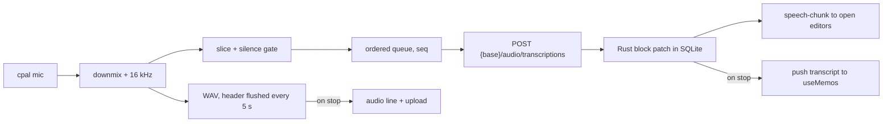

# Voice-to-text and LLM edits

Suggested delivery order, each one shippable alone:

0. **Server limits.** A sync fix that is useful on its own.
1. **LLM edits.** Independent of audio and the lowest risk.
2. **Recording plus attachment.** A recording ends with a speech block, an audio file and a transcript made in one pass on stop.
3. **Live slices.** The transcript fills in while you talk.

## Format: local markers, remote text

Local note, which is what Memose edits:

```markdown
[memose-speech-UUID]: # "audio=voice-UUID.wav"
The transcript is normal paragraphs.
[memose-speech-end-UUID]: #

```

**Change from the first draft: the marker lines are not pushed.** [content_for_remote](src-tauri/src/media.rs) trims every line and drops blank lines. The pushed body therefore has no blank line before `[memose-speech-end-…]: #`. In CommonMark a link reference definition cannot interrupt a paragraph, so the end marker would show as literal text in useMemos. It also depends on the useMemos renderer supporting reference definitions at all. Instead:

- `content_for_remote` drops marker lines, the same way it drops media tokens. The pushed body is only the transcript. That removes any dependency on the useMemos markdown renderer.
- An unchanged remote memo is already a no-op on pull (`local_text == memo.content` in [sync.rs](src-tauri/src/notes/sync.rs)), so the markers survive.
- When the remote body changed, `merge_local_media` keeps only media lines today. Extend it so that if the block's transcript (start and end lines) is still contiguous in the remote text, the markers wrap it again. Otherwise the result degrades to a paragraph plus a normal audio block, as the first draft already accepted.

Audio attachment:

- A `.wav` uploads as `audio/wav` (`mime_for_name`). Current useMemos plays it ([AudioAttachmentItem](https://github.com/usememos/memos/blob/e4f3fb2d/web/src/components/MemoMetadata/Attachment/AudioAttachmentItem.tsx)). Older useMemos offers it as a download.
- **The audio line is added only on stop, after the WAV is finalized.** Sync uploads every referenced file and records the upload in `media_upload_for_local`. A file uploaded once is never uploaded again, so a partial WAV pushed mid-take would stay truncated on the server permanently. While recording, the editor shows a placeholder built from the `audio=` name in the start marker.
- **Pull binds by label, not by stored name.** `save_named` stores a downloaded file as `{uuid8}-{sanitized}.wav`. On a second device the stored name differs, but the label stays `voice-UUID.wav`.
- **Delete recording** removes the file and the audio line and keeps the text. `sync_memo_attachments` calls `link_memo_attachments` only when `refs` is non-empty. With the last ref gone, the remote attachment would never be unlinked. Patch with an empty list when a note had uploads and now has no refs.

Limits:

- **Text.** The transcript counts toward the server's memo content limit (see [Server limits](#server-limits)). On the old 8 KiB default, normal speech (about 900 characters a minute) reaches it after roughly 9 minutes. On a server with no limit, a take is not cut short. While recording, warn at 90 % of the limit in effect. Show no warning when the limit is unlimited.
- **File.** The roll-over size is the smaller of the local `MAX_MEDIA_BYTES` (32 MB) and the server's `upload_bytes`, minus a 10 % margin. On a server with no upload limit, the local cap applies. 16 kHz mono 16-bit audio is 32 KB/s, so 32 MB is reached at about 17 minutes. Uploads are base64 inside JSON (+33 %), and the useMemos server has its own upload limit (32 MiB by default). Roll over to `voice-UUID-2.wav` at about 20 MB (~10 min) and list both files in the marker (`audio=a.wav,b.wav`). FLAC (pure-Rust `flacenc`, roughly half the size, plays in WebKit and Chromium) is a follow-up option. Opus needs libopus and has uneven WebKit support, so skip it.

## Server limits

Memose hard-codes `MEMOS_CONTENT_LIMIT = 8192` ([model.rs](src-tauri/src/notes/model.rs)) and counts `chars()` ([sync.rs](src-tauri/src/notes/sync.rs)). useMemos lets an admin change the limit or remove it, so Memose should use the limit the server actually applies. This is a general sync fix and should land before the voice work.

How the server defines the limit (from the useMemos source):

- **Current** (26.10.0 and later): the `USAGE_LIMITS` instance setting is per user. A client reads its own limit from `GET /api/users/{user}/usage` → `limits.memoContentBytes`, and `limits.uploadBytes` for files. **An unset value or 0 means unlimited.** Going over returns `RESOURCE_EXHAUSTED`, reason `QUOTA_EXCEEDED`, with metadata `metric`, `limit` and `usage`.
- **Older:** `MemoRelatedSetting.contentLengthLimit` from `GET /api/v1/instance/settings/MEMO_RELATED`, or `/api/v1/workspace/settings/MEMO_RELATED` on still older servers.
- **Oldest:** a fixed 8 KiB.

In every version the size is the content's **UTF-8 bytes**, not characters. Counting `chars()` lets Finnish text (`ä`, `ö` are 2 bytes each) pass the local check and then fail on the server. Switch to `str::len()`.

Plan:

- New `server_limits` probe in [sync.rs](src-tauri/src/notes/sync.rs). Try the endpoints above in order, using the same `/api/v1` and then `/api` fallback that `upload_attachment` uses, and fall back to 8192. Store `{memo_content_bytes, upload_bytes, checked_at}` in `meta`, where `0` means unlimited. Run it on sync start, at most once an hour, and whenever the base URL or token changes.
- The push check uses the stored value: skip the check when it is unlimited, and use `remote.len() > limit` otherwise. The error message names the real limit, e.g. "content exceeds 16 KB on this server".
- If a push still fails with `QUOTA_EXCEEDED` and `metric = memo_content_bytes`, store the `limit` from the error, mark the note as an error, and stop retrying until the note changes or the limit is raised. That keeps an admin change effective without waiting for the next probe.
- **Over the limit (decided): show a sync error and keep the note locally.** No splitting and no truncation. The note keeps all its content and stays editable, including the full transcript and audio file. Its sync status shows the error with the limit, e.g. "Too long for this server (9.1 KB / 8 KB)". The next sync retries it when the note shrinks below the limit or a probe finds a higher limit or none. A recording does not stop at the limit. It keeps writing locally, and the warning changes to "Will not sync until shortened".
- `get_settings` returns `memoContentLimit` and `uploadLimit`. The editor shows a byte counter only above 80 % of a finite limit. The LLM diff and the recording warning use the same value.
- Remove `MEMOS_CONTENT_LIMIT` as a constant and keep 8192 only as the fallback default.

## Live mode: slices of the recording become text

This path uses the speech server, not the chat model.

- Capture stays in Rust (`cpal`), including after the memo window closes. Devices usually deliver 44.1 or 48 kHz `f32`, often stereo. Downmix and resample to 16 kHz (`rubato`, or a FIR decimator when 48k→16k). The first draft left this out.
- **Slicing.** A slice ends on ~700 ms of quiet, with a minimum of 1 s and a maximum of ~12 s. At the maximum, cut at the lowest-energy 100 ms within the last second. The first draft's 4 s maximum cuts words often and gives Whisper too little context.
- **Silence gate.** Skip slices whose RMS is below a threshold. Whisper invents text on silence ("Thanks for watching", "Kiitos katsomisesta"). Leave the beep's ~200 ms out of capture.
- **Requests.** `POST {speechBase}/audio/transcriptions` with `model`, `language` (from settings, empty means auto), `response_format=json`, and `prompt` set to the last ~200 characters. Language matters: auto-detect on short slices flips languages, especially for Finnish.
- **Ordering.** Slices carry a `seq`. One request is in flight per session, and the rest wait in a FIFO queue. Retry with backoff. When offline, keep queuing; the WAV is always the source of truth. The shared client's 10 s timeout ([state.rs](src-tauri/src/state.rs)) is too short for a cold local model. Use a per-request `.timeout()` of about 60 s.
- **Final pass (optional setting).** On stop, if slices failed or are still queued, transcribe the full file once and replace the block's text. A 10-minute 16 kHz WAV is about 19 MB, under OpenAI's 25 MB limit.

### One writer for the transcript

Rust owns the session's transcript. Every chunk is written to SQLite through a block-scoped patch, and nothing replaces the whole note. If an editor shows that note, Rust also emits `speech-chunk {noteId, blockId, seq, text}`.

The first draft's split (editor saves through `save_edit` when open, Rust patches when closed) races. Hiding the composer triggers `composer-flush`, which writes the editor's whole content through `save_edit` ([composer.rs](src-tauri/src/window_ctl/composer.rs)). A chunk patched in between is overwritten. The same race exists between the pin window and stack sections showing one note. Fix:

- The editor inserts chunk text at the end marker as its own undo step. It does not merge with typing.
- `save_edit` for the recording note re-applies any chunk with `seq` greater than what the saved content contains. The session keeps the appended chunks, and the editor sends its highest applied `seq`.
- If the end marker is gone (the user deleted it, or a pull degraded the block), append after the last transcript line and recreate the end marker.

### Sync during a take

Every chunk would call `request_sync`, which turns into an `update_memo` every few seconds. Hold pushes for the recording note while the session runs, push once on stop, and on stop also run the attachment upload.



## Settings

New **Voice & models** tab in [settings.html](settings.html) and [src/settings.ts](src/settings.ts). Values live in SQLite `meta`. Keys are stored like the useMemos token: in SQLite, since the keychain copy is legacy-imported ([auth.rs](src-tauri/src/auth.rs)). Keys are never logged and are never echoed in `AppError` bodies. `get_settings` returns `hasSpeechKey` and `hasLlmKey`, not the secrets.

- Speech on/off, default off. The record button is hidden until this is on.
- **Base URLs include the version prefix**, the same convention as the OpenAI SDKs: `https://api.openai.com/v1`, `https://api.groq.com/openai/v1`, `http://localhost:11434/v1`, `http://localhost:8000/v1`. Paths are then joined as `/audio/transcriptions`, `/models` and `/chat/completions`. The first draft's `{base}/v1/…` breaks Groq. Trim a trailing `/`.
- Speech: API key (optional), model, **language**. Model chips: `whisper-1` (OpenAI), `whisper-large-v3-turbo` (Groq), `Systran/faster-whisper-small` (Speaches). whisper.cpp's server needs `--inference-path /v1/audio/transcriptions`; mention this in the help text.
- Microphone. Applied on the next recording. Application/loopback capture is out of this pass.
- Resume beep on/off, default on.
- Final pass on stop, on/off.
- LLM on/off, default off. Prompt buttons are hidden until this is on.
- LLM: base URL, API key (optional), model. Chips: `qwen2.5:7b` (Ollama), `gpt-4o-mini` (cloud).
- Editable presets: **Summarize**, **Action items**, **Clean up wording**.
- **Test** button per endpoint. The speech test sends a 1 s generated silence and expects a 200 response.

Refresh calls `GET {base}/models`. For Ollama detection, strip the trailing `/v1` and `GET /api/version`. If that answers, also list `/api/tags`, and **Download** runs `POST /api/pull`. That call streams NDJSON progress for minutes, so it needs its own request with no total timeout, a progress bar, and cancel. Otherwise show the model id and one line: `ollama pull <model>`, or load it in the app serving this URL. No model runtime is bundled. No LangChain. Add the `multipart` and `stream` features to `reqwest` in [Cargo.toml](src-tauri/Cargo.toml); neither is enabled today.

Privacy: show the endpoint host next to each toggle, with a "local" badge for loopback hosts. For notes in an offline-private audience (`is_offline_private`, never synced), ask once before sending audio or text to a non-local host.

## Recording session

New [src-tauri/src/speech.rs](src-tauri/src/speech.rs) on `AppState`. One session at a time.

- Mic button in [index.html](index.html), in the `#card` header before pin. Target is the host memo, or the stack section that has focus. A draft is upserted first so it has an id.
- Another note already recording: this button does not start a second take. It shows which note is recording.
- Stop from that button, a left-click on the tray icon, or a **Stop recording** tray menu item. Tray click events are not delivered on Linux, so the menu item is required there. While recording, the left click does not open the composer. [tray.rs](src-tauri/src/tray.rs) swaps in a recording icon.
- Hiding the composer, closing the pin window, or turning pinned mode off does not stop the session.
- **Target note deleted mid-take:** stop, keep the WAV, and create a new note holding the speech block. Words are never lost.
- **Device lost** (unplugged, sleep): cpal reports a stream error. Finalize, stop, and show it on the tray.
- WAV via `hound`. Call `flush()` every ~5 s so the header stays valid. Release builds use `panic = "abort"`, so `Drop` does not run on a crash. Store the active session (note, block, file) in `meta`. On start, an orphaned session's WAV is repaired, the audio line is added, and the transcript is finished from the file if the final pass is on. Finalize on stop and on app exit.
- macOS: `NSMicrophoneUsageDescription` in [Info.plist](src-tauri/Info.plist). The app is ad-hoc signed (`signingIdentity: "-"`). macOS keys the microphone grant to the code signature, so expect a new prompt, or a stale grant, after each update. Verify this on an update path before release. If hardened runtime is ever enabled, add the `com.apple.security.device.audio-input` entitlement.
- Linux: `cpal` needs `libasound2-dev` in [ci.yml](.github/workflows/ci.yml) and [release.yml](.github/workflows/release.yml).
- Beep: once the take is longer than 60 s, if 30 s of silence is followed by voice, play one short beep on the default output, so you know the mic is still live. The edge is local amplitude, not the model reply, and it plays with no window open. Generate a sine through a `cpal` output stream instead of adding `rodio`; `rodio` would pull in a decoder stack for one tone.

## Speech block in Memose

New block kind in [src/editor/markdown-edit.ts](src/editor/markdown-edit.ts), parsed from the reference-line pair. One shared DOM helper, used by [editor-controller.ts](src/app/controllers/editor-controller.ts) and [stack/editor.ts](src/stack/editor.ts):

- The existing audio player from [media-elements.ts](src/media/media-elements.ts), the transcript, and **Delete recording**.
- While recording: a pulsing "recording" placeholder instead of the player, plus a **Stop** button.
- The marker lines are never visible or editable as text. Deleting the whole block removes both markers and asks before deleting the file.

## LLM prompts

[src-tauri/src/llm.rs](src-tauri/src/llm.rs) makes one `/chat/completions` call per prompt. The user message holds the instruction and the memo text. Audio bytes are never sent.

**Ask or edit.** A prompt has a mode:

- **Ask** answers in the chat and never changes the memo ("how many tasks are open?"). The note is context, and general knowledge is allowed.
- **Edit** proposes new text, shown as a diff.
- **Auto** (the default for typed prompts) first asks the model one yes/no question without the note: does the request ask to change the note's text? Yes runs Edit, anything else runs Ask. This was the reliable form on a 7B local model. Letting the model mark its own reply (`EDIT`/`ANSWER` lines, `<revised>` tags) was not: it skipped the marks and often echoed the note.

In every mode the note comes first in the user message and the request last. With the request first, small models continued the note instead of answering.

Presets carry their own mode. An answer can still be added to the memo or reviewed as a replacement.

**Selection as the source.** Selecting text in the editor, the coder editor, or the preview shows a small **AI** tab beside the selection. It opens the bubble with that selection as the source:

- The prompt box shows "Lines 3–7" and a clear button that goes back to the whole memo.
- The selected lines are sent as the part to work on, with the whole memo as context. An edit replaces only those lines.
- Lines are found by comparing text without markdown marks, so a preview selection works too. When the place is not unique, the whole memo is the source and the selection is passed as a hint.

**AI prompt bubble** ([src/ai/llm-edit.ts](src/ai/llm-edit.ts)). The AI button in the memo header opens a bubble that floats over that memo:

- The chat of this memo: each prompt, then its answer, its diff, or its error.
- A running prompt shows a spinner, the elapsed time and **Cancel**. Prompts running for other memos are listed under "Also running".
- The AI button turns a ring while a prompt for this memo runs, and shows a dot when a result arrived while the bubble was closed. Opening a memo with a running prompt opens its bubble.
- Escape and a click on the memo close the bubble before anything else reacts.
- One prompt box in the style of an editor chat input: the text on top, and the mode, the model (click to switch), and send along its bottom edge.
- Presets sit on one row and shrink in a narrow memo. Those that do not fit go behind **More…**.
- The chat lives in Rust `AppState` (`llm_chats`, keyed by memo id), so it survives closing the memo window. It is dropped when the app quits.
- Line diff from `src/editor/line-diff.ts`: red removed, green added, **Accept** and **Keep original** per change, **Accept all**, **Dismiss**. Accepted text saves through the editor as one undo step.
- Colors come from one AI scheme, the `--ai-*` variables in [controls.css](src/styles/controls.css), derived from the memo's paper and ink shifted toward one tint.

Safeguards:

- **Protected lines.** Media tokens and speech markers are removed before sending and are not part of the diff. They are restored at their anchors afterwards.
- **Stale check.** An edit stores the text it was computed from. If the memo text changed before accept, nothing is applied and the bubble says to run the prompt again.
- Per-request timeout of 180 s (CPU-bound local models are slow). Streaming is not needed.
- An offline-only memo asks once before its text goes to a non-local host.
- A warning shows when the accepted result would exceed the server's content limit.

Stack sections have the same AI button and bubble as the host memo, each with its own chat. A code block shows the AI tab in its top right corner on hover, and the prompt then works on that block only ("Code block, lines 3–4").

Still open: Ollama pull from settings.

## Tests

- Marker lines round-trip locally, including a transcript that contains backticks or starts with `[`.
- `content_for_remote` drops marker lines and audio tokens and keeps the transcript. Pull re-anchors the markers when the transcript is intact and degrades cleanly when it is not. Pull binds the attachment by label when the stored name differs.
- The audio line is absent until stop. No upload of an unfinalized file.
- Delete recording unlinks the remote attachment when no refs remain.
- Block patch changes only that block. Chunk `seq` re-apply after a `composer-flush` that lacked the newest chunk.
- Slice queue delivers in `seq` order despite out-of-order replies. The silence gate drops quiet slices.
- Base URL joining for OpenAI, Groq, Ollama (`/v1` stripping for `/api/version`), and a trailing `/`.
- Beep decision. Tray click stops only while a session exists.
- WAV recovery from an unfinalized file.
- Server limits: the usage endpoint with a set limit, with 0 or unset (unlimited), the older `MEMO_RELATED` setting, and the 8192 fallback when every probe fails. The size is counted in bytes, so 5,000 `ä` characters are over an 8 KiB limit. A `QUOTA_EXCEEDED` reply stores the reported limit. A note over the limit keeps its full content locally, shows the error, and syncs once it is shortened or the limit is raised.
- Line diff: one hunk, accept all, cancel, stale source, protected lines untouched.
- Playwright with mocked IPC: buttons hidden when off, speech block placeholder and delete, diff accept. Real microphone capture is manual.

New IPC names in [src-tauri/src/lib.rs](src-tauri/src/lib.rs) stay in lockstep with [tests/frontend.test.ts](tests/frontend.test.ts).

## Open questions

- WAV with rollover now, or FLAC from the start?
- Should the final pass be on by default when the speech server is local?
